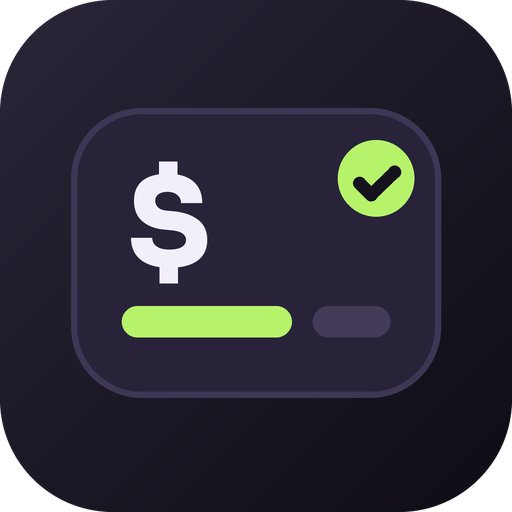
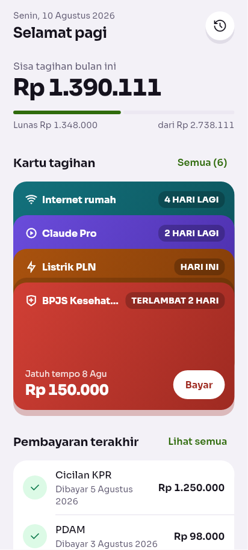
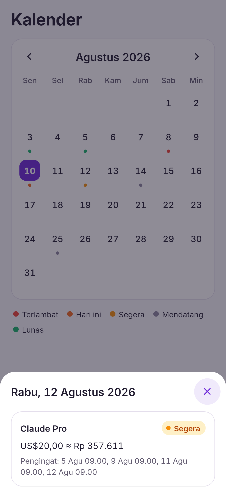
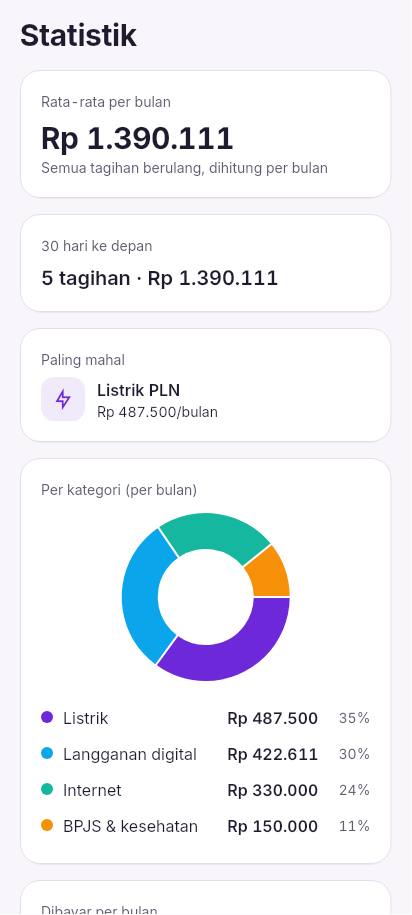
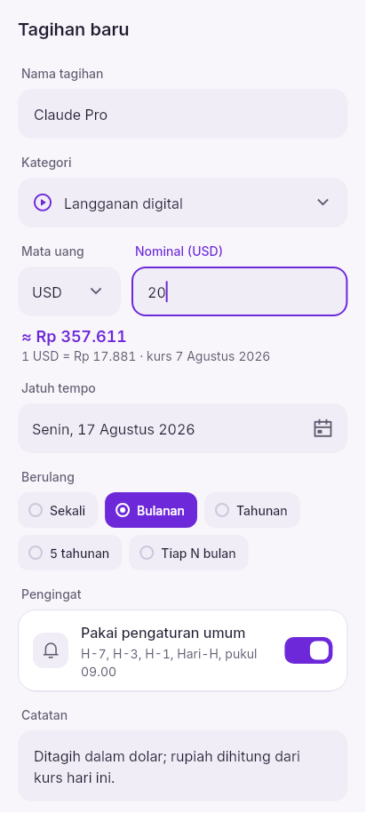
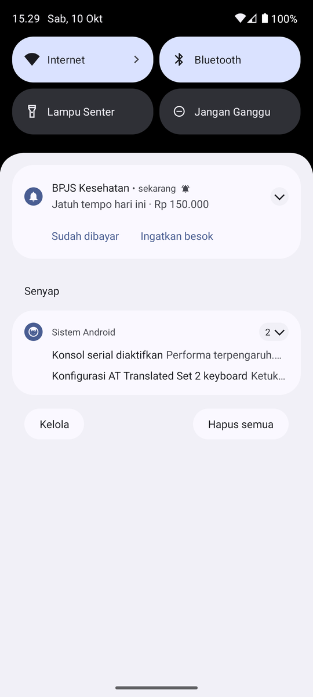
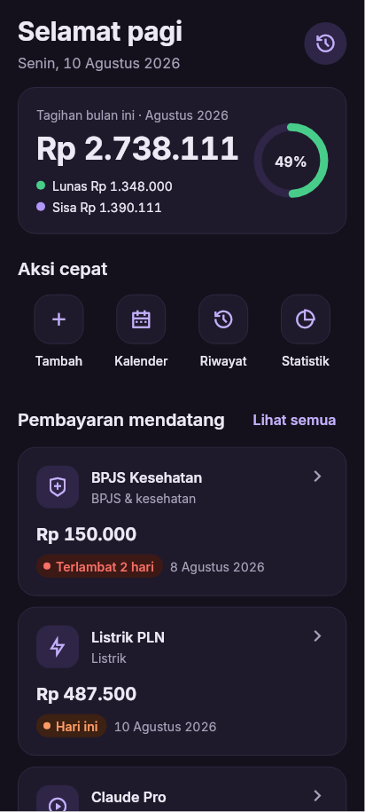

<p align="center">
  
</p>

<h1 align="center">B4Due</h1>

<p align="center">
  Pengingat tagihan &amp; langganan untuk Indonesia.<br>
  <b>Tanpa akun. Tanpa server. Tanpa iklan. Gratis.</b>
</p>

<p align="center">
  <a href="https://github.com/ryanffirdaus/b-4-due/actions/workflows/ci.yml"></a>
  <a href="LICENSE"></a>
</p>

<p align="center"><a href="#english">English below</a></p>

---

## Apa ini?

Listrik PLN, internet, cicilan, BPJS, pajak motor, Netflix... gampang sekali ada yang
lupa dibayar. **B4Due** mengirim notifikasi sebelum jatuh tempo (H-7, H-3, H-1, dan hari-H),
lalu Anda cukup menekan **"Sudah dibayar"** langsung dari notifikasi. Tagihan bulan
berikutnya otomatis dibuat.

Semua data hanya tersimpan di HP Anda. Internet **hanya** dipakai untuk satu hal: mengambil
kurs mata uang hari ini (misalnya untuk langganan Claude atau ChatGPT yang ditagih dalam
dolar). Permintaan itu tidak membawa data Anda sama sekali.

| Beranda | Kalender | Statistik |
|:---:|:---:|:---:|
|  |  |  |
| **Mata uang asing** | **Notifikasi** | **Mode gelap** |
|  |  |  |

## Fitur

- **Pengingat otomatis**: H-7, H-3, H-1, dan hari-H, di jam yang Anda pilih. Bisa diatur per tagihan.
- **Tombol di notifikasi**: "Sudah dibayar" mencatat riwayat dan membuat jatuh tempo berikutnya. "Ingatkan besok" menunda 24 jam.
- **Tagihan berulang**: sekali, bulanan, tahunan, 5 tahunan (perpanjang STNK), atau tiap N bulan. Tanggal 31 tetap tanggal 31, termasuk setelah Februari.
- **Template Indonesia**: Listrik PLN, PDAM, BPJS Kesehatan, pajak kendaraan, PBB, KPR, kartu kredit, paylater, Netflix, Spotify, dan lainnya.
- **Mata uang asing**: isi harga dalam USD, EUR, SGD, JPY, dan lainnya. B4Due langsung menampilkan perkiraan rupiah dengan kurs hari ini (sumber: Bank Sentral Eropa lewat [Frankfurter](https://frankfurter.dev)), lalu memperbaruinya otomatis. Tanpa internet, kurs terakhir tetap dipakai.
- **Beranda**: total bulan ini dengan progres yang sudah lunas, aksi cepat, pembayaran mendatang, dan pembayaran terakhir. Geser kartu ke kanan untuk menandai lunas, ke kiri untuk menghapus.
- **Kalender**: titik berwarna per status (terlambat, hari ini, segera, mendatang, lunas); ketuk tanggal untuk melihat tagihan, nominal, dan jam pengingatnya.
- **Statistik**: rata-rata pengeluaran per bulan, tagihan 30 hari ke depan, langganan paling mahal, diagram per kategori, dan grafik pembayaran 6 bulan terakhir.
- **Cadangan tanpa server**: file JSON lewat Google Drive/WhatsApp/kartu memori Anda sendiri, ekspor CSV untuk Excel, dan Android Auto Backup.
- **Kunci aplikasi** (opsional): PIN atau sidik jari/wajah.
- **Cadangan lewat kalender** (opsional): tambahkan tagihan ke kalender HP lengkap dengan alarm, untuk HP yang suka mematikan notifikasi aplikasi.
- **Bahasa Indonesia**, format Rupiah (Rp 1.250.000), dan tanggal Indonesia (17 Agustus 2026). Mode terang dan gelap mengikuti sistem, huruf minimal 14sp, dan tetap rapi saat ukuran huruf sistem diperbesar.

## Cara install

1. Buka halaman **[Releases](https://github.com/ryanffirdaus/b-4-due/releases/latest)** dari HP Anda.
2. Unduh file **`b4due-…-arm64-v8a.apk`**. File ini cocok untuk hampir semua HP Android 7.0 ke atas. Jika gagal dipasang, unduh versi **`universal`**.
3. Buka file yang sudah diunduh. Jika muncul peringatan "Untuk keamanan, HP Anda tidak diizinkan menginstal aplikasi tidak dikenal":
   - ketuk **Setelan**,
   - aktifkan **Izinkan dari sumber ini** (untuk browser atau File Manager yang Anda pakai),
   - kembali, lalu ketuk **Instal**.
4. Buka B4Due dan ikuti panduan awal. Di akhir panduan, tekan **Tes notifikasi sekarang** untuk memastikan semuanya bekerja.

> Setelah terpasang, Anda boleh mematikan lagi "Izinkan dari sumber ini". Untuk pembaruan, cukup pasang APK versi baru di atas versi lama; data tidak hilang.

### Pembaruan otomatis (Obtainium)

[Obtainium](https://github.com/ImranR98/Obtainium) (gratis, open source) memeriksa GitHub
Releases dan memasang versi baru B4Due tanpa Play Store.

1. Pasang Obtainium dari [halaman rilisnya](https://github.com/ImranR98/Obtainium/releases/latest) (`app-arm64-v8a-release.apk`).
2. Di Obtainium, tekan **Tambah aplikasi**, isi URL `https://github.com/ryanffirdaus/b-4-due`.
3. Pilih jalurnya:
   - **Stabil**: biarkan pengaturan bawaan. Anda hanya mendapat rilis resmi (`v0.1.0`, `v0.2.0`, ...).
   - **Nightly** (versi terbaru dari setiap perubahan di `main`, untuk penguji): aktifkan
     **Sertakan prarilis** (*Include prereleases*). Setiap commit yang lulus CI menjadi
     pre-release `X.Y.Z-nightly.N` beberapa menit kemudian.
4. Isi **Filter APK** dengan `arm64-v8a` (atau `universal` untuk HP lama), lalu **Tambah** dan **Instal**.
5. Agar pembaruan terpasang sendiri di latar belakang, aktifkan *Pembaruan latar belakang* di
   pengaturan Obtainium (Android 12+ dapat memasang tanpa konfirmasi untuk aplikasi yang
   dipasang lewat Obtainium).

> Rilis resmi dan nightly ditandatangani dengan kunci yang sama dan nomor build-nya selalu naik,
> jadi Anda bisa berpindah jalur kapan saja tanpa kehilangan data. APK dari `flutter run`/debug
> memakai kunci lain: hapus dulu versi debug sebelum memasang dari Releases.

<details>
<summary>Ingin memastikan file APK asli? (opsional)</summary>

Setiap rilis menyertakan `SHA256SUMS.txt` dan sidik jari sertifikat penanda tangan. Di komputer:

```sh
sha256sum b4due-*.apk                       # bandingkan dengan SHA256SUMS.txt
apksigner verify --print-certs b4due-*.apk  # bandingkan SHA-256 dengan catatan rilis
aapt2 dump permissions b4due-*.apk          # INTERNET ada (hanya untuk kurs); tidak ada izin lokasi, kontak, dsb.
```
</details>

## Agar notifikasi tidak terlewat

Banyak HP (terutama Xiaomi, OPPO, realme, vivo, Infinix) menutup aplikasi di latar
belakang demi menghemat baterai. B4Due sudah berusaha keras: alarm presisi, penjadwalan
ulang setelah HP dinyalakan ulang, dan pengecekan cadangan dua kali sehari. Meski begitu,
Anda tetap perlu memberi izin **satu kali**.

Cara termudah: buka **Pengaturan > Pengaturan baterai** di B4Due. Aplikasi akan mendeteksi
merek HP Anda, menampilkan langkah yang sesuai, dan menyediakan tombol pintas ke layar pengaturan HP.

| Merek | Yang perlu diatur |
|---|---|
| **Xiaomi / Redmi / POCO** | Setelan > Aplikasi > Kelola aplikasi > B4Due: aktifkan **Mulai otomatis**, lalu **Penghemat baterai** pilih **Tanpa batasan**. Kunci kartu B4Due di layar aplikasi terbaru. |
| **OPPO / realme / OnePlus** | Setelan > Aplikasi > Manajemen aplikasi > B4Due > **Penggunaan baterai**: izinkan aktivitas latar belakang dan mulai otomatis. |
| **vivo / iQOO** | Setelan > Baterai > **Konsumsi daya latar belakang tinggi**: aktifkan B4Due. Lalu Setelan > Aplikasi > **Mulai otomatis**: aktifkan B4Due. |
| **Samsung** | Setelan > Aplikasi > B4Due > Baterai: **Tidak dibatasi**. Pastikan B4Due tidak ada di daftar "Aplikasi tidur". |
| **Infinix / Tecno / itel** | Setelan > Aplikasi > B4Due > Baterai: **Tanpa batasan**. Lalu Phone Master > **Mulai otomatis**: aktifkan B4Due. |
| **Lainnya** | Setelan > Aplikasi > B4Due > Baterai: **Tidak dibatasi / Tidak dioptimalkan**. |

Nama menu bisa sedikit berbeda tergantung versi sistem. Panduan sangat lengkap per merek
tersedia di [dontkillmyapp.com](https://dontkillmyapp.com). Sebagai lapisan kedua, Anda bisa
menekan **Tambahkan ke Kalender** di halaman tagihan, sehingga alarm kalender HP ikut mengingatkan.

## Cadangan &amp; pindah HP

B4Due tidak punya server, jadi cadangan disimpan di tempat **milik Anda sendiri**:

1. **Otomatis lewat Google (paling mudah).** Android mencadangkan data B4Due ke Google Drive
   Anda jika *Cadangan Google* aktif (Setelan > Google > Cadangan, atau Setelan > Sistem >
   Cadangan). Saat menyiapkan HP baru dengan akun Google yang sama dan memilih "pulihkan dari
   cadangan", data B4Due ikut kembali setelah aplikasi dipasang. Transfer kabel/nirkabel
   langsung antar-HP saat penyiapan juga didukung.
2. **File cadangan (paling pasti).** Di B4Due buka **Pengaturan > Cadangan & pindah HP**:
   - **Bagikan file cadangan** untuk mengirimnya ke Google Drive, email, atau chat WhatsApp ke diri sendiri, atau
   - **Simpan file cadangan** ke folder HP atau kartu memori.

   Di HP baru: pasang B4Due, lalu **Pulihkan dari file cadangan** dan pilih file tadi.
3. **Ekspor ke spreadsheet (CSV).** Daftar tagihan dan riwayat pembayaran untuk Excel atau
   Google Sheets. Ini untuk dibaca, bukan untuk dipulihkan.

Catatan:
- PIN kunci aplikasi **tidak** ikut dalam file cadangan; buat PIN baru di HP baru.
- Tanda "Ada di kalender" juga tidak ikut; tekan Tambahkan ke Kalender lagi bila perlu.
- File cadangan tidak dienkripsi. Simpan di tempat yang hanya bisa Anda akses.

## FAQ

**Apa saja yang dikirim lewat internet?**
Tidak ada data Anda. B4Due hanya mengunduh daftar kurs dari `api.frankfurter.dev` (paling
sering dua kali sehari), tanpa akun, tanpa ID perangkat, dan tanpa nama atau nominal tagihan.
Jika Anda hanya memakai Rupiah, tidak ada permintaan sama sekali selain pengecekan kurs
berkala itu; pengingat tetap berjalan sepenuhnya offline. Lihat [PRIVACY.md](PRIVACY.md).

**Kursnya dari mana dan seberapa akurat?**
Kurs referensi harian Bank Sentral Eropa (hari kerja). Bank atau kartu Anda biasanya
mengenakan kurs dan biaya sedikit berbeda, jadi nominal rupiah selalu ditandai sebagai perkiraan.

**Kenapa notifikasi saya telat atau tidak muncul?**
Hampir selalu karena penghemat baterai HP. Ikuti bagian [Agar notifikasi tidak terlewat](#agar-notifikasi-tidak-terlewat),
lalu tekan **Tes notifikasi sekarang** di Pengaturan.

**Bagaimana jika nominal tagihan berubah-ubah (misalnya listrik)?**
Isi perkiraan dan centang "Nominal ini perkiraan", atau kosongkan saja nominalnya.

**Saya bayar lebih awal. Apa yang terjadi dengan pengingatnya?**
Tekan "Sudah dibayar" kapan saja. Pengingat untuk periode itu langsung dibatalkan, dan jatuh tempo berikutnya dibuat.

**Saya lupa PIN.**
PIN tidak bisa dipulihkan karena tidak ada server. Hapus data aplikasi (Setelan HP > Aplikasi >
B4Due > Penyimpanan > Hapus data), lalu pulihkan dari file cadangan jika ada.

**Ada versi iPhone?**
Kodenya disiapkan agar bisa dibangun untuk iOS, tetapi belum ada rilis iOS karena distribusinya
membutuhkan akun Apple Developer berbayar.

**Kenapa tidak ada di Play Store?**
Supaya tetap gratis dan tanpa biaya bagi siapa pun. Aplikasi ini disiapkan agar kompatibel dengan F-Droid.

---

## Untuk pengembang

### Build dari source

Kebutuhan: [FVM](https://fvm.app) (atau Flutter 3.47.7, sesuai `.fvmrc`), JDK 17, dan Android SDK 36.

```sh
git clone https://github.com/ryanffirdaus/b-4-due.git && cd b-4-due
fvm install                     # Flutter versi yang dipin
fvm flutter pub get
fvm flutter run                 # debug di emulator/HP
fvm flutter build apk --release --split-per-abi
```

Build release tanpa keystore akan memakai kunci debug, jadi tetap bisa dijalankan di HP sendiri.
SQLite untuk Android dikompilasi dari source yang di-vendor di `third_party/sqlite3`
(syarat F-Droid: tidak ada binary prebuilt yang diunduh saat build).

### Tes

```sh
fvm flutter analyze --fatal-infos
fvm flutter test                          # unit, widget, migrasi, isolate, golden
fvm flutter test integration_test -d <id> # di emulator/HP
dart run build_runner build               # setelah mengubah tabel Drift
dart run drift_dev make-migrations        # setelah menaikkan schemaVersion
```

Golden test dibandingkan secara ketat hanya di Linux (sama seperti CI). Untuk memperbarui
gambar acuan, jalankan `flutter test --update-goldens` di Linux.

### Arsitektur singkat

- **Feature-first** (`lib/features/<fitur>/{data,domain,presentation}`), Riverpod untuk state, go_router untuk navigasi.
- **Drift/SQLite** dengan migrasi bertahap yang dites dari setiap versi skema sebelumnya, ID UUID, dan soft delete.
- **Penjadwalan sebagai fungsi murni**: `planNotifications(tagihan, pengaturan, sekarang)` menghasilkan daftar notifikasi dengan ID deterministik. `ReminderSync` lalu menyamakan antrean OS dengan daftar itu (idempotent, tidak pernah dobel).
- **Aksi notifikasi di background isolate** memakai isolate database Drift yang dibagi bersama, dalam transaksi yang idempotent per periode.

Detail lengkap ada di [docs/ARCHITECTURE.md](docs/ARCHITECTURE.md) dan format file cadangan di [docs/BACKUP_FORMAT.md](docs/BACKUP_FORMAT.md).

### Rilis

Versi mengikuti [Semantic Versioning](https://semver.org/) dan diatur otomatis oleh
[release-please](.github/workflows/release-please.yml) dari pesan commit (`fix` → PATCH,
`feat` → MINOR, `!` → MAJOR). Setiap push ke `main` memperbarui PR rilis berisi versi baru dan
CHANGELOG. Saat PR itu di-merge, tag `vX.Y.Z` dibuat dan [`release.yml`](.github/workflows/release.yml)
membangun APK bertanda tangan, memeriksa izin, lalu melampirkannya ke GitHub Release.
Alur issue → commit → rilis ada di [CONTRIBUTING.md](CONTRIBUTING.md#alur-kerja). Secrets yang dibutuhkan (di *environment* `release`):

| Secret | Isi |
|---|---|
| `B4DUE_KEYSTORE_BASE64` | `base64 -w0 release.jks` |
| `B4DUE_KEYSTORE_PASSWORD` | password keystore |
| `B4DUE_KEY_ALIAS` | alias kunci |
| `B4DUE_KEY_PASSWORD` | password kunci |

Membuat keystore (sekali saja, **jangan di-commit**, simpan cadangannya baik-baik):
`keytool -genkeypair -v -keystore release.jks -alias b4due -keyalg RSA -keysize 4096 -validity 10000`

Lihat juga [CONTRIBUTING.md](CONTRIBUTING.md) dan [ROADMAP.md](ROADMAP.md).

## Lisensi

[MIT](LICENSE). Font [Inter](https://github.com/rsms/inter) berlisensi SIL OFL 1.1. Ikon [Remix Icon](https://remixicon.com) v4.8.0 berlisensi Apache 2.0. Kurs dari [Frankfurter](https://frankfurter.dev) (data Bank Sentral Eropa).

---

<a id="english"></a>

## English

**B4Due** is a bill and subscription reminder for Indonesia: no account, no server, no ads,
free. It reminds you 7, 3 and 1 day before a bill is due and on the day
itself, and lets you tap **"Sudah dibayar"** (paid) right on the notification. The next due date
is then created automatically. All data stays on your phone.

**Features:** automatic reminders (customizable per bill); notification actions (paid,
remind me tomorrow); one-off, monthly, yearly, 5-yearly or every-N-months bills; templates
for common Indonesian bills (PLN, PDAM, BPJS, vehicle tax, KPR, Netflix…); prices in foreign
currencies (USD, EUR, SGD, JPY…) with a live rupiah estimate; a home screen with the monthly
total, swipe to mark paid, a calendar view and spending statistics; payment history; JSON backup and restore
through your own storage; CSV export; Android Auto Backup; optional PIN or biometric lock;
optional calendar events as a second reminder layer. Light and dark mode follow the system.
The UI is Indonesian-first with English included.

**Install:** download `b4due-…-arm64-v8a.apk` (or `universal`) from
[Releases](https://github.com/ryanffirdaus/b-4-due/releases/latest), allow installs from that
source when Android asks, and follow the in-app setup. It ends with a test notification.
For automatic updates add the repository to [Obtainium](https://github.com/ImranR98/Obtainium);
enable *Include prereleases* to follow the nightly builds published after every green CI run on `main`.

**Missed notifications:** usually caused by the phone's battery saver. Open *Pengaturan >
Pengaturan baterai* in the app for steps tailored to your phone's brand (see also
[dontkillmyapp.com](https://dontkillmyapp.com)).

**Backup / new phone:** Android Auto Backup (your Google Drive) restores B4Due's data
automatically on a new phone. For a sure-fire copy, use *Pengaturan > Cadangan & pindah HP*
to share or save a JSON backup file, then restore it on the new phone. The app-lock PIN is
never included in backups.

**Privacy:** the only network use is downloading exchange rates from `api.frankfurter.dev`
(an anonymous GET carrying none of your data). Everything else stays on the phone and reminders
work fully offline. See [PRIVACY.md](PRIVACY.md).

**Build from source:** Flutter 3.47.7 (pinned in `.fvmrc`), JDK 17, Android SDK 36, then
`flutter pub get && flutter build apk --release --split-per-abi`. Architecture notes are in
[docs/ARCHITECTURE.md](docs/ARCHITECTURE.md), contribution guidelines in
[CONTRIBUTING.md](CONTRIBUTING.md).

License: [MIT](LICENSE). Icons: [Remix Icon](https://remixicon.com) v4.8.0 (Apache 2.0).
